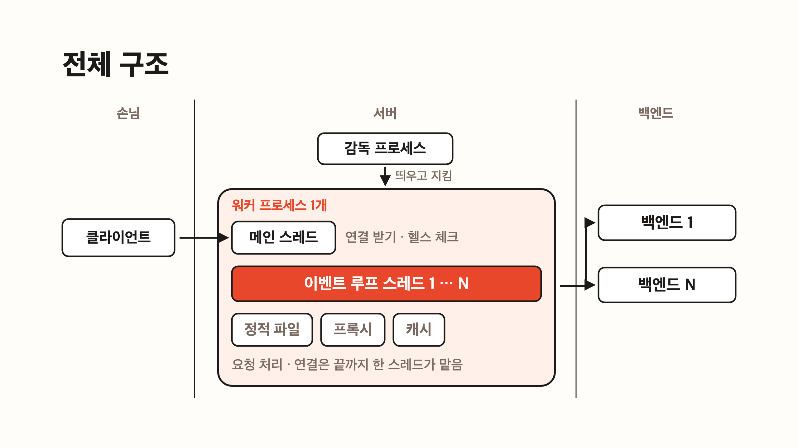
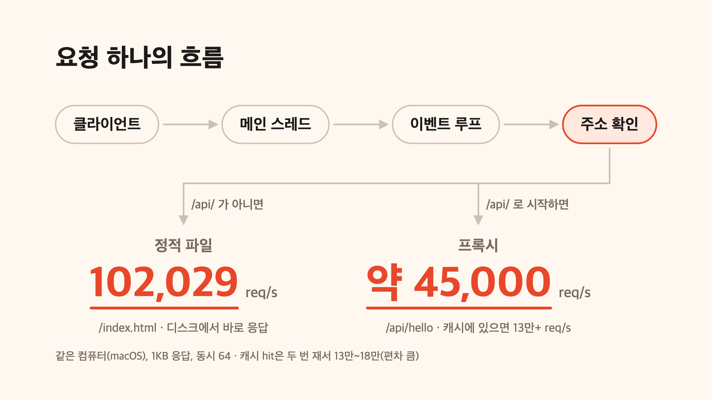
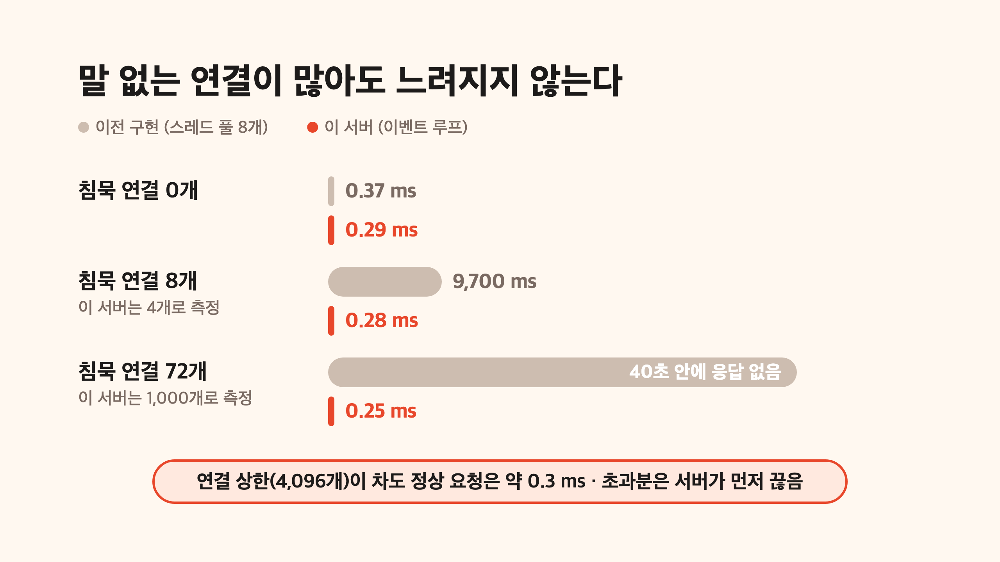
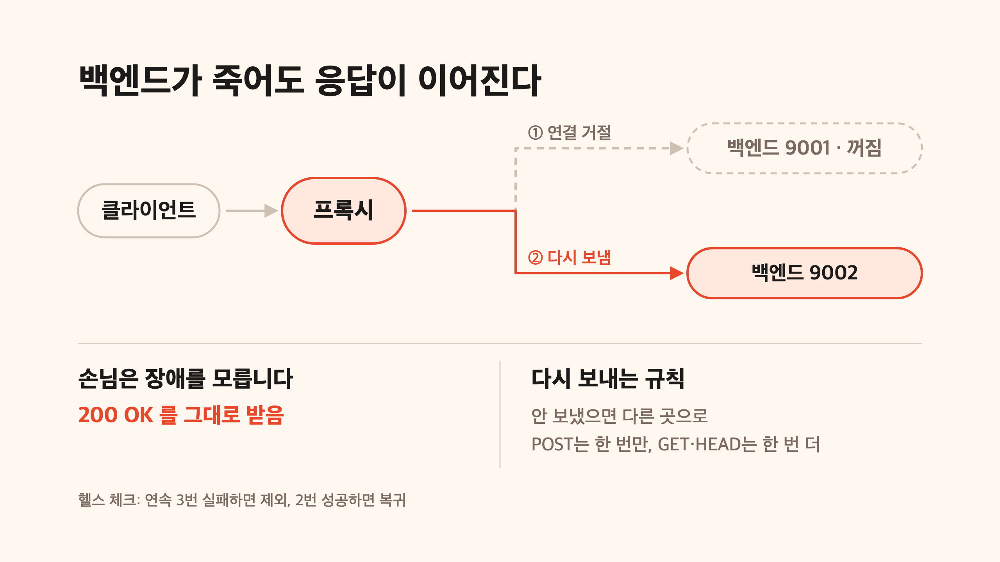
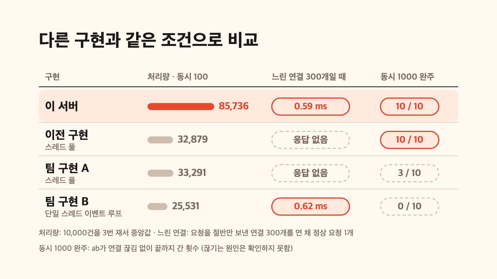

<h1></h1>

**Krafton Jungle WEEK13 · Team 10** · [@picky232](https://github.com/picky232) · [@rlatmdgus388](https://github.com/rlatmdgus388) · [@a01030704572-bit](https://github.com/a01030704572-bit)

HTTP 라이브러리 없이 **C11과 POSIX 소켓만으로 만든 HTTP/1.1 서버**입니다.
파일을 직접 주고, 요청을 백엔드에 대신 전달하는 리버스 프록시도 합니다.

## 전체 구조

## 동작 흐름

메인 스레드가 연결을 받아 이벤트 루프 스레드에 넘기고, 경로 규칙에 따라 **정적 파일**이나 **프록시**로 처리됩니다. 프록시는 캐시를 먼저 보고, 없을 때만 가장 한가한 백엔드에 보냅니다.

- **프록시 수치** : 이 서버의 정적 모드를 가벼운 백엔드 2대로 두고 같은 컴퓨터에서 잰 값이라 실제 앱 백엔드보다 가볍고, 부하 도구·프록시·백엔드가 CPU를 나눠 썼습니다.
- **req/s**(초당 요청 수) : 서버가 1초 동안 끝까지 처리해 응답한 HTTP 요청의 수입니다. 클수록 같은 시간에 더 많은 사용자를 받을 수 있습니다. 부하 도구 `ab`가 동시에 N개 연결로 1KB 파일을 계속 요청해서 쟀습니다.
- **구조** : 워커 **프로세스 1개** 안에 **메인 스레드** 1개(연결 받기, 백엔드 헬스 체크)와 **루프 스레드** N개(요청 처리, 코어 수만큼)가 있습니다. 루프 스레드는 이벤트 루프를 돌리는 스레드이고, 요청을 보낼 **백엔드를 고르는 것도 루프 스레드**입니다.

---

## 차별점

### 01 · 연결 하나는 끝까지 한 스레드가 전담합니다

메인 스레드가 연결을 연결 수가 가장 적은 루프에 한 번 배정하면, 그 연결의 읽기·처리·쓰기는 모두 같은 스레드 안에서 끝납니다. 그래서 연결 처리에 **락이 필요 없습니다**. 대신 한 루프에서 오래 걸리는 일을 하면 그 루프의 연결이 모두 기다립니다.

연결을 한 스레드에 고정하는 방식은 실제 서버들도 씁니다. 이들도 **프로세스 1개 안에 스레드 여러 개**를 두고 스레드마다 이벤트 루프를 돌리는 구조입니다. 아래 표의 "워커 스레드"는 이 서버의 **루프 스레드**에 해당합니다.

| 서버 | 구조 |
|---|---|
| [Envoy](https://www.envoyproxy.io/docs/envoy/latest/intro/arch_overview/intro/threading_model) | 워커 스레드마다 이벤트 루프를 돌고, 연결은 수명 내내 한 워커 스레드에 묶입니다 |
| [HAProxy](https://haproxy.com/blog/multithreading-in-haproxy) | 스레드마다 이벤트 루프를 돌고, 한 연결은 한 스레드가 담당합니다. 백엔드 연결 재사용도 같은 스레드 안에서만 되는 점이 이 서버와 같은 감수입니다 |
| [Netty](https://netty.io/4.0/api/io/netty/channel/EventLoopGroup.html) | Channel은 수명 내내 하나의 EventLoop(스레드)에 등록됩니다 |
| [memcached](https://sources.debian.org/src/memcached/1.6.39-1/thread.c) | 메인(dispatcher) 스레드가 연결을 받아 워커 스레드에 넘기고, 워커 스레드마다 이벤트 루프를 돕니다 |
| [nginx](https://www.nginx.com/blog/inside-nginx-how-we-designed-for-performance-scale/) | **다른 점**: 스레드 대신 워커 **프로세스**를 코어 수만큼 여러 개 두고, 워커마다 스레드 1개로 이벤트 루프를 돕니다 |

서버마다 설정에 따라 세부 동작은 다를 수 있습니다(2026-11-25 확인).

### 02 · 말 없는 연결이 많아도 다른 요청은 느려지지 않습니다

**침묵 연결**(연결만 맺고 아무것도 보내지 않는 연결)은 이 서버도 들고 있습니다. 다른 점은 **스레드를 붙잡느냐**입니다.

| | 스레드 풀 (이전 구현) | 이벤트 루프 (이 서버) |
|---|---|---|
| 침묵 연결을 | 워커 1개가 붙어서 데이터가 올 때까지 잠들어 기다림 | 들고만 있고, "데이터가 오면 알려 달라"고 커널에 맡김 |
| 침묵 연결 8개가 오면 | 워커 8개가 모두 묶임. 정상 요청은 워커가 풀릴 때까지 대기 → **9.7초** | 스레드는 그대로 자유. 정상 요청을 바로 처리 → **0.28 ms** |
| 끝 | 제한 시간이 지나야 풀림 | 10초 뒤 서버가 먼저 끊음 (기본값) |

침묵 연결 하나는 수백 바이트만 써서, 상한(4,096개)까지 들고 있어도 서버 메모리는 1~2 MB만 늘었고 정상 요청은 계속 약 0.3 ms였습니다.

### 03 · 연결이 늘어도 처리량이 유지됩니다

이 서버는 동시 16부터 약 10만 req/s에서 평평하게 유지됩니다. 일하는 루프 스레드가 코어 수(8개)로 고정이라 연결이 늘어도 일꾼이 늘지 않고, 기다리는 연결은 커널이 지켜보기 때문입니다. 이전 스레드 풀은 워커가 8개뿐이라 동시 연결이 8개를 넘으면 나머지가 기다려서 3만 req/s 안팎으로 내려갔습니다(동시 4: 56,299 → 16: 33,583). 동시 64에서 **3.8배**, 동시 500에서 p99 지연도 11 ms 대 116 ms입니다.

- **p99** : 요청 100개 중 99개가 이 시간 안에 끝났다는 뜻입니다. 느린 쪽 1%를 뺀 최대 지연입니다.

**연결이 너무 많으면?** 연결 상한은 기본 4,096개(루프 스레드 8개 × 루프당 512개)입니다. 아직 받기 전의 연결은 커널 대기열에서 기다리고, 상한을 넘으면 쉬는 연결·아무것도 안 보낸 연결부터 내보내 자리를 만듭니다. 그래도 자리가 없으면 `503`과 `Retry-After: 1`로 돌려보냅니다. 위 처리량 시험(동시 500)은 이 상한에 닿지 않았습니다. 침묵 연결을 4,596개 열어 보면 서버는 4,096개만 들고 있고 초과분 500개는 서버가 먼저 끊으며, 그동안에도 정상 요청은 200 OK로 처리됩니다.

### 04 · 백엔드가 죽어도 응답이 이어집니다

연결이 거절되면 그 백엔드를 바로 제외하고, 요청을 한 바이트도 보내지 않았다면 다른 백엔드로 다시 보냅니다. 처리됐는지 알 수 없는 **POST는 다시 보내지 않아** 같은 요청이 두 번 처리되지 않습니다.

### 05 · 감독 프로세스가 워커를 지킵니다

설정을 바꿀 때는 새 워커가 준비된 뒤에 옛 워커를 내보냅니다. 연결을 받는 소켓을 감독이 쥐고 있어서 교체 중에도 새 연결을 받을 수 있고, 새 연결 30만 건 × 3회 동안 실패가 없었습니다. 워커를 강제로 죽이면 109 ms, 얼리면 11초 만에 새 워커가 응답합니다. 이미 맺어 둔 keep-alive 연결은 교체 때 끊겨서 클라이언트가 다시 연결해야 합니다.

---

## 테스트와 결과

직접 만든 입력을 서버에 넣고 응답 코드와 걸린 시간, 열린 fd·메모리를 잰 값입니다. 같은 종류의 시험은 자동화되어 있어서, 모듈별 단위 검사 2,678개와 실제 서버에 소켓으로 요청하는 기능 시험 100개가 `make test`로 돌고, ASan·UBSan·TSan으로 같은 기능 시험을 돌려도 보고가 없었습니다(2026-11-24).

## 비교 테스트

세 가지 동시성 모델을 재서 이벤트 루프를 골랐습니다.

| 모델 | 대표 | 처리량 | 약점 |
|---|---|---|---|
| 요청마다 프로세스 | CGI (지움) | 약 3,300 req/s (동시 8, keep-alive 없음. 같은 조건 정적 파일 37,100) | 프로세스를 만드는 비용이 요청마다 듭니다 |
| 스레드 풀 | 이전 구현 | 27,078 req/s (동시 64) | 침묵 연결 8개에 정상 요청이 9.7초 걸립니다 |
| **이벤트 루프 N개** | **이 서버** | **102,029 req/s** (동시 64) | 루프 안에서 오래 걸리는 일은 그 루프를 늦춥니다 |

CGI 값은 CGI를 지우기 전 커밋 `15f3bfa`에서 잰 값이라 조건이 다릅니다.

팀의 다른 구현 셋과도 같은 조건으로 재 봤습니다.

- 처리량은 이 서버가 다른 구현의 **2.6~3.4배**입니다(동시 100).
- 느린 연결 300개가 붙어도 **이벤트 루프 구조**(이 서버, 구현 B)는 정상 요청을 0.6 ms에 처리하지만, 스레드 풀 구현은 5초 안에 응답하지 못했습니다.
- 동시 1000 연결을 한꺼번에 여는 시험은 구현마다 끊기는 정도가 달랐고, 이 서버도 연속으로 잴 때는 3회 중 1회 끊긴 적이 있어 끊기는 **원인은 확인하지 못했습니다**.
- 다른 구현은 팀원이 만든 코드라 이름 대신 구조로 표시했습니다. 측정은 2026-11-25, 같은 컴퓨터(macOS)입니다.

## 한계

HTTPS, HTTP/2, 범위 요청, 압축, WebSocket 중계는 아직 없습니다. 조건과 전체 설명은 [상세 README](docs/README-상세.md)에 있습니다.
