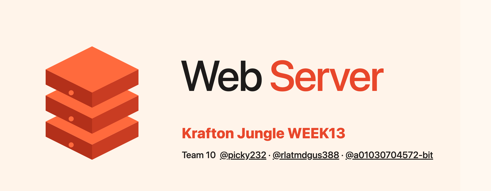
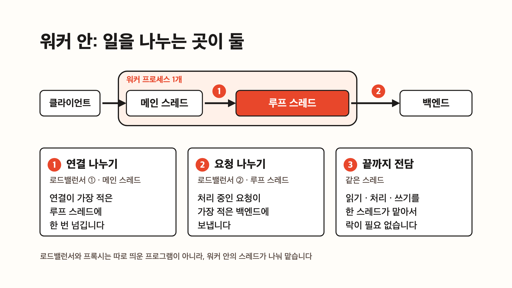
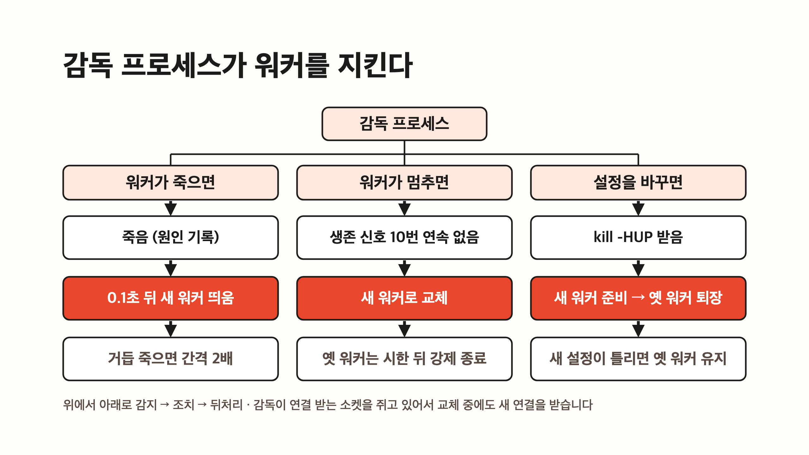

<h1></h1>

**Krafton Jungle WEEK13 · Team 10** · [@picky232](https://github.com/picky232) · [@rlatmdgus388](https://github.com/rlatmdgus388) · [@a01030704572-bit](https://github.com/a01030704572-bit)

정적 파일을 직접 응답하고, 백엔드 서버로 요청을 중계하는 **리버스 프록시** 역할도 하는 HTTP 서버입니다.

**설계는 한 줄입니다. 요청을 처리하는 워커 프로세스를 1개만 두어 구조를 단순하게 지키고, 그 대가는 감독 프로세스가 메웁니다.**

## 전체 구조

- **감독 프로세스** : 요청을 처리하지 않고 워커를 띄우고 지켜보다가, 죽거나 멈추면 새 워커로 바꿉니다. `-s` 옵션으로 실행해야 켜집니다.
- **워커 프로세스** : 요청을 실제로 처리하는 프로세스입니다. **1개만 둡니다.**
- **메인 스레드** : 워커 안에서 새 연결을 받아 **연결 수가 가장 적은 루프 스레드**에 나눠 주고(로드밸런서 ①), 2초마다 백엔드가 살아 있는지 확인합니다(헬스 체크). 요청은 처리하지 않습니다.
- **루프 스레드** : 이벤트 루프를 도는 스레드로, 코어 수만큼 둡니다. 요청 처리, 프록시(요청을 백엔드에 대신 전달), 백엔드 고르기(로드밸런서 ②)는 여기서 합니다.

## 왜 워커 프로세스를 1개로 했나

워커 프로세스를 여러 개 두는 방식은 흔합니다. 예를 들어 nginx는 `worker_processes auto`로 코어 수만큼 워커 프로세스를 둡니다([출처](https://www.f5.com/company/blog/nginx/tuning-nginx)). 하나가 죽어도 일부 요청만 잃기 때문입니다. 이 서버는 반대로 1개만 둡니다.

| | 워커 1개 (이 서버) | 워커 여러 개 (검토하고 버림) |
|---|---|---|
| 처리량 | 루프 스레드가 코어 수만큼 이미 나눠 일합니다 | 프로세스를 늘려도 얻는 게 없다고 판단했습니다 |
| 하나가 죽으면 | 서비스 전체가 멈춥니다. 감독 프로세스가 새 워커로 바꿉니다 | 일부 요청만 잃습니다. **얻는 것은 이 장애 격리 하나뿐입니다** |
| 캐시 | 하나를 모두가 씁니다 | 워커마다 따로입니다. 한 워커가 저장한 응답을 다른 워커는 모릅니다 |
| 백엔드 동시 요청 상한 | 한곳에서 정확히 셉니다 | 워커마다 따로 셉니다. 상한이 4이고 워커가 둘이면 백엔드는 최대 8개를 받습니다 |

여러 개로 얻는 것은 장애 격리 하나인데, 그 대가로 캐시와 동시 요청 상한 관리가 복잡해집니다. 그래서 워커를 1개로 하고, 장애는 감독 프로세스가 새 워커로 바꾸는 것으로 대신했습니다.

버린 안이 하나 더 있습니다. 죽은 워커를 이전 상태에서 fork해 되살리는 방법인데, 커널의 소켓과 백엔드 상태는 과거로 돌아가지 않아서 요청이 깨지거나 POST가 두 번 처리될 수 있습니다.

이 비교는 설계 판단이고, 워커 여러 개를 만들어 재 본 것은 아닙니다. "프로세스를 늘려도 얻는 게 없다"도 재 보지 않았습니다.

## 한 개로 충분한가: 다른 구현과 비교

프로세스가 하나여도 루프 스레드가 코어 수만큼 나눠 일합니다. 같은 조건에서 팀의 다른 구현 셋과 처리량을 비교했습니다.

| 구현 | 구조 | 초당 처리 건수 |
|---|---|---|
| **이 서버** | 프로세스 1개, 이벤트 루프 스레드 여러 개 | **85,736** |
| 이전 구현 | 스레드 풀 | 32,879 |
| 팀 구현 A | 스레드 풀 | 33,291 |
| 팀 구현 B | 단일 스레드 이벤트 루프 | 25,531 |

접속 100개를 동시에 열어 1KB 파일을 계속 요청하고(`ab -k`, 10,000건) 3번 재서 중앙값을 냈습니다(같은 컴퓨터 macOS, 2026-11-25). 이 서버가 다른 구현의 **2.6~3.4배**입니다. 워커 수가 아니라 구조 전체의 비교라서 "한 개라서 빠르다"가 아니라 "한 개로도 부족하지 않다"는 근거입니다. 다른 구현은 팀원이 만든 코드라 이름 대신 구조로 적었습니다.

연결 상한은 기본 4,096개이고, 넘으면 쉬는 연결부터 내보내 자리를 만들고 그래도 없으면 `503`을 돌려줍니다.

## 워커 안: 로드밸런서와 프록시는 스레드가 나눠 맡습니다

로드밸런서와 프록시는 따로 띄운 프로그램이 아니라, 워커 안의 스레드가 나눠 맡습니다. 로드밸런서 역할은 둘이고, 고르는 기준이 각각 있습니다.

| | 누가 | 무엇을 나누나 | 고르는 기준 | 코드 |
|---|---|---|---|---|
| **① 연결 분배** | **메인 스레드** | 새 연결 → 루프 스레드 | **연결 수가 가장 적은 루프 스레드.** 동점이면 돌아가며 고릅니다(안 그러면 짧은 연결이 전부 첫 루프로만 쏠립니다) | `src/main.c` `pick_loop` |
| **② 요청 분배** | 루프 스레드 | 요청 → 백엔드 | 처리 중인 요청이 가장 적은 백엔드(`least_conn`). 백엔드별 동시 상한 안에서 고릅니다 | `src/balance.c` `pool_pick` |

- **왜 ①이 필요한가** : 연결은 한 번 배정하면 끝까지 한 스레드가 맡기 때문에, 배정하는 순간에 연결 수가 가장 적은 루프를 골라야 합니다.
- **왜 ②가 따로 있나** : 같은 연결에서도 요청마다 백엔드가 달라질 수 있고, 백엔드마다 속도가 달라서 요청마다 고릅니다.
- **프록시** : 연결을 맡은 루프 스레드가 요청을 백엔드에 대신 전달하고, 응답을 받아 돌려줍니다.
- **연결 전담** : 한 번 배정된 연결의 읽기·처리·쓰기는 끝까지 같은 스레드가 합니다. 두 스레드가 한 연결을 같이 만지지 않아서 연결 처리에는 락이 필요 없습니다. 대신 한 루프에서 오래 걸리는 일을 하면 그 루프의 연결이 모두 기다립니다.
- **로드밸런서는 둘 다 함수 하나입니다** : 따로 띄운 프로그램이나 스레드가 아니라, ①은 메인 스레드가 ②는 연결을 맡은 루프 스레드가 부르는 함수입니다. 요청이 한 번 더 건너가지 않습니다.
- **워커가 1개라서 정확합니다** : 연결 수와 처리 중인 요청 수를 모든 스레드가 한 곳(메모리 변수)에서 세므로, ①②의 최소 연결 판단과 백엔드별 동시 상한이 정확합니다.
- **요청 본문을 다 받은 뒤에 백엔드를 고릅니다** : 그렇게 하지 않으면 느린 업로드가 백엔드를 오래 붙잡습니다.

**최소 연결이 효과가 있었나** : 백엔드 두 대 중 하나가 요청마다 0.2초씩 느릴 때 두 방식을 비교했습니다.

같은 컴퓨터(macOS)에서 동시 접속 16개로 10초씩 번갈아 3번 쟀고, 3번 모두 같은 방향이었습니다. 한쪽이 극단적으로 느린 경우이고, 두 백엔드가 비슷할 때는 재지 않았습니다. 백엔드가 파이썬 서버라 절대값보다 차이를 봐야 합니다.

## 대가: 죽거나 멈추면 서비스 전체가 멈춥니다

감독 프로세스는 워커가 죽으면 0.1초 뒤 다시 띄우고, 멈추면(1초마다 생존 신호를 확인해 10번 연속 없을 때) 새 워커로 바꿉니다. 설정을 바꿀 때도 새 워커가 준비된 뒤에 옛 워커를 내보냅니다. 연결을 받는 소켓은 감독이 쥐고 있어서 교체 중에도 새 연결이 대기열에서 기다립니다.

**실제로 어떻게 되는지 쟀습니다** : 스레드 16개가 요청을 계속 보내는 중에 워커에 신호를 보냈습니다.

죽였을 때의 실패 4~6건은 죽는 순간 처리 중이던 요청입니다(3회). 얼렸을 때는 그 순간 처리 중이던 4건만 25초가 지나도 응답이 없었고, 새로 들어온 요청은 모두 11초 늦게 처리됐습니다.

설정을 바꾸는 중에도 새 연결 30만 건 × 3회에서 실패가 없었습니다.

## 한계

**정리** : 워커를 1개로 해서 구조를 단순하게 지켰고, 그 대가는 감독 프로세스로 메웠습니다.

- 죽는 순간 처리 중이던 요청은 잃습니다. 워커가 여러 개였다면 일부만 잃었을 것입니다.
- 워커를 얼려서 교체하면, 얼린 워커가 쥐고 있던 연결은 25초가 지나도 풀리지 않았습니다(처리 중이던 4건).
- 설정을 바꿀 때 이미 맺어 둔 keep-alive 연결은 끊깁니다. 원인은 코드로 확인하지 못했습니다.
- 워커 여러 개와의 비교는 만들어 재 보지 않았고, 최소 연결 시험은 한쪽이 극단적으로 느린 경우만 재었습니다.
- HTTPS, HTTP/2, 범위 요청, 압축, WebSocket 중계는 아직 없습니다.

자동 검사는 `make test`로 모듈별 단위 검사 2,678개와 실제 서버에 소켓으로 요청하는 기능 시험 100개를 돌립니다(2026-11-25). 조건과 전체 설명은 [상세 README](docs/README-상세.md)에 있습니다.

## 더 보기

처리량 추이(접속 1~500), 요청 하나의 흐름, 말 없는 연결, 백엔드 장애, 엣지 케이스 시험, 다른 구현과의 비교

